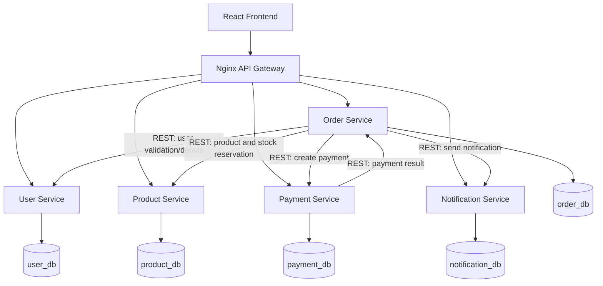

# Target Architecture

## 1. Logical architecture

## 2. Service independence

Each service:
- Has its own Django project and settings.
- Has its own URL configuration.
- Owns its models and migrations.
- Connects only to its own database.
- Exposes REST endpoints.
- Has its own tests and Dockerfile.
- Can be started independently.

A service must not import another service's Django models or query another service's database.

## 3. Communication

Use synchronous REST calls for the first implementation. This is easier to build, inspect, test, and explain for a university project.

Example internal URLs on the Docker network:
- `http://user-service:8000`
- `http://product-service:8000`
- `http://order-service:8000`
- `http://payment-service:8000`
- `http://notification-service:8000`

Align these names with the final Docker Compose service names.

## 4. Gateway responsibility

Nginx provides:
- A single public entry point.
- Path-based routing.
- Request forwarding.
- Basic request-size and timeout configuration.
- Authorization header forwarding.

Nginx is a lightweight reverse proxy/API gateway for this project, not a full API management platform. Backend services must still enforce authentication and authorization.

## 5. Reliability rules

- Set connection timeouts for service calls.
- Handle unavailable downstream services.
- Do not blindly retry non-idempotent operations.
- Use idempotency keys for payment creation or callbacks where appropriate.
- Log request IDs where practical.
- Never assume a remote service call and a local database write form one atomic transaction.
