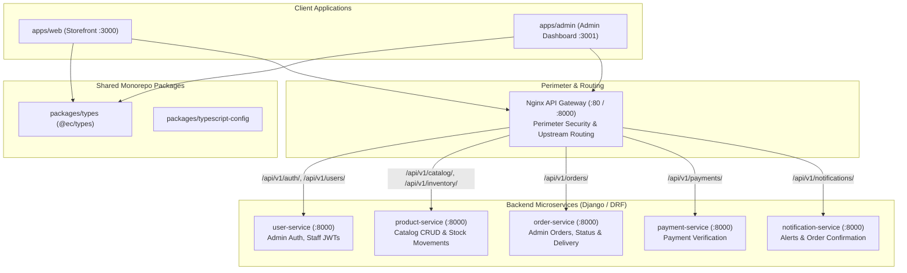

# Admin Dashboard (Inventory, Orders & Catalog) Implementation Plan

> **For Antigravity:** REQUIRED WORKFLOW: Use `.agent/workflows/execute-plan.md` to execute this plan in single-flow mode.

**Goal:** Build a dedicated, modular Next.js 16 Admin Dashboard in `apps/admin` within the Turborepo monorepo, paired with microservice backend extensions across `user-service`, `product-service`, `order-service`, and the Nginx API gateway, to empower administrators with full control over inventory stock levels, order fulfillment lifecycle, and product catalog.

**Architecture:** Monorepo architecture where `apps/admin` sits alongside `apps/web` sharing common types from `@ec/types`. The Admin frontend communicates through the unified Nginx API Gateway with strict Role-Based Access Control (`is_staff` / `is_superuser`), consuming extended endpoints in Django microservices (`product-service` for catalog CRUD & stock adjustment audit logs, `order-service` for admin order queue & status management, and `user-service` for admin authentication).

**Tech Stack:** Next.js 16 (App Router), React 19, TypeScript 5, Tailwind CSS v4, Lucide-React / Heroicons, Turborepo monorepo packages (`@ec/types`), Django REST Framework, PostgreSQL, Nginx API Gateway.

---

## 1. Git Workflow Protocol (Mandatory per `contribution.md`)

All contributions to this implementation plan must strictly follow the repository's feature-branch workflow:

```text
development → feat/admin-dashboard-implementation → Implement → Test → Commit → Push → PR to development
```

> [!CAUTION]
> **NEVER TOUCH `main`!**
> `development` is the authoritative base and working branch. All feature branches, commits, pushes, and Pull Requests must target `development`. Never switch to, merge into, or push to `main`.

### Git Workflow Execution Sequence:
1. **Inspect Repository:** Verify working tree is clean on `development`.
2. **Synchronize:** `git fetch origin` & `git pull origin development`.
3. **Branch:** Create dedicated feature branch:
   ```bash
   git checkout -b feat/admin-dashboard-setup
   ```
4. **Iterative Development & Frequent Commits:** Bite-sized atomic commits with conventional commit messages (`feat: ...`, `fix: ...`, `test: ...`).
5. **Full Verification:** Run linters, unit tests, and production build before pushing.
6. **Push & Pull Request:** Push branch to remote and submit PR targeting `development`.

---

## 2. Architecture & Monorepo Topology



---

## 3. User Review Required

> [!IMPORTANT]
> **Authentication & Authorization Strategy:**
> We leverage Django's built-in `is_staff` and `is_superuser` flags on `User`. The JWT `access_payload` in `user-service` is augmented to include `is_staff` and `is_superuser`. An `IsAdminOrStaffUser` DRF permission class secures all backend administrative endpoints.
> In the frontend (`apps/admin`), an Auth Guard and Next.js middleware verify both token validity and `is_staff` authorization.

> [!NOTE]
> **Port Allocation & Dev Workflow:**
> - `apps/web`: `http://localhost:3000` (Default Next.js)
> - `apps/admin`: `http://localhost:3001` (Configured via `next dev -p 3001`)
> - API Gateway: `http://localhost:8000` (Forwarding to internal Docker services or local ports)

---

## 4. Proposed Feature Modules & Requirements

### Module A: Stock & Inventory Management
1. **Inventory Table:** View all products and variants with SKU, Size, Color, Current Stock, Price, and Stock Status (`In Stock`, `Low Stock (< 10)`, `Out of Stock`).
2. **Stock Adjustment & Restock:** Modal dialog allowing staff to select a variant, choose movement type (`RESTOCK`, `ADJUSTMENT`, `RETURN`), enter quantity change (e.g. +50 or -5), and provide mandatory audit notes.
3. **Movement History / Audit Log:** Chronological ledger of all inventory transactions (`apps/inventory/models.py` `StockMovement`) displaying timestamp, SKU, user/reason, change, and resultant balance.
4. **Low Stock Alerts:** Real-time visual pill count on dashboard and filter tab on inventory screen.

### Module B: Order Lifecycle & Fulfillment
1. **Admin Orders Queue:** View all customer orders with server-side pagination, search by Order Number (`ORD-...`), customer name, or phone number.
2. **Order Status Workflow:** Tabbed filters: `ALL`, `PENDING`, `CONFIRMED`, `PROCESSING`, `SHIPPED`, `DELIVERED`, `CANCELLED`.
3. **Admin Order Detail:**
   - Customer snapshot (Name, Email, Phone, Telegram, Delivery Address).
   - Order items summary (Product, Variant, SKU, Quantity, Unit Price, Total).
   - Payment status badge (`PAID`, `UNPAID`, `REFUNDED`).
   - Shipment & Fulfillment details (Courier, Tracking number, Rider dispatch status).
   - Status transition actions with reason notes.

### Module C: Product Catalog Management
1. **Product List:** Searchable table with Thumbnail, Title, Category, Department, Audience, Base Price, Total Stock, and Active toggle.
2. **Product Form (Create / Edit):**
   - Title, Slug (auto-generated), Description, Category dropdown, Department, Audience, Fabric, Base Price.
   - Variant Matrix Builder: Generate combinations (e.g., Sizes: S, M, L, XL; Colors: Black, Olive, White) with individual SKU, price override, and initial stock.
   - Image URL management.

### Module D: Dashboard Overview & Analytics
1. **KPI Metric Cards:**
   - Total Gross Revenue ($ USD).
   - Total Orders Count & Breakdown.
   - Pending Fulfillment Orders (Needs packing/shipping).
   - Low Stock Alert Count.
2. **Recent Activity Feed:** Latest 10 orders with quick-action status drawer.

---

## 5. Detailed Phased Tasks

### Phase 1: Backend Microservices Admin Extensions

#### Task 1: Admin Authorization & JWT Augmentation in `user-service`
**Files:**
- Modify: `backend/services/user-service/apps/accounts/authentication.py`
- Modify: `backend/services/user-service/apps/accounts/views.py`
- Test: `backend/services/user-service/tests/test_admin_auth.py`

**Step 1: Write failing test for admin authentication & token claims**
```python
# backend/services/user-service/tests/test_admin_auth.py
from django.test import TestCase
from django.contrib.auth import get_user_model
from rest_framework.test import APIClient
from rest_framework import status
from apps.accounts.authentication import generate_tokens_for_user, decode_token

User = get_user_model()

class AdminAuthTestCase(TestCase):
    def setUp(self):
        self.client = APIClient()
        self.admin = User.objects.create_superuser(
            email="admin@clothes.ec",
            username="ec_admin",
            password="AdminPassword123!"
        )
        self.customer = User.objects.create_user(
            email="user@clothes.ec",
            username="ec_user",
            password="UserPassword123!"
        )

    def test_jwt_claims_include_staff_status(self):
        admin_tokens = generate_tokens_for_user(self.admin)
        admin_payload = decode_token(admin_tokens['access'])
        self.assertTrue(admin_payload.get('is_staff'))
        self.assertTrue(admin_payload.get('is_superuser'))

        customer_tokens = generate_tokens_for_user(self.customer)
        customer_payload = decode_token(customer_tokens['access'])
        self.assertFalse(customer_payload.get('is_staff'))
        self.assertFalse(customer_payload.get('is_superuser'))

    def test_admin_login_endpoint_rejects_non_staff(self):
        res = self.client.post('/api/v1/auth/admin/login/', {
            "email": "user@clothes.ec",
            "password": "UserPassword123!"
        })
        self.assertEqual(res.status_code, status.HTTP_403_FORBIDDEN)
```

**Step 2: Run test to verify failure**
```bash
pytest backend/services/user-service/tests/test_admin_auth.py -v
```

**Step 3: Implement minimal code**
- Update `access_payload` in `generate_tokens_for_user` to include `'is_staff': user.is_staff`, `'is_superuser': user.is_superuser`.
- Add `AdminLoginView` in `apps/accounts/views.py` that verifies `user.is_staff or user.is_superuser`.
- Register `/api/v1/auth/admin/login/` in `apps/accounts/urls.py`.

**Step 4: Run test to verify pass**
```bash
pytest backend/services/user-service/tests/test_admin_auth.py -v
```

**Step 5: Commit**
```bash
git add backend/services/user-service/
git commit -m "feat(user-service): add admin login and staff jwt claims"
```

---

#### Task 2: Inventory Stock Management & Audit Endpoints in `product-service`
**Files:**
- Create: `backend/services/product-service/apps/core/admin_permissions.py`
- Modify: `backend/services/product-service/apps/inventory/serializers.py`
- Modify: `backend/services/product-service/apps/inventory/views.py`
- Modify: `backend/services/product-service/apps/inventory/urls.py`
- Test: `backend/services/product-service/tests/test_admin_inventory.py`

**Step 1: Write failing test for Admin Stock Adjustment & Movement Log**
```python
# backend/services/product-service/tests/test_admin_inventory.py
from decimal import Decimal
from django.test import TestCase
from rest_framework.test import APIClient
from rest_framework import status
from apps.catalog.models import Category, Product, ProductVariant
from apps.inventory.models import StockMovement

class AdminInventoryTestCase(TestCase):
    def setUp(self):
        self.client = APIClient()
        self.category = Category.objects.create(name="Tops", slug="tops")
        self.product = Product.objects.create(
            title="Classic Linen Shirt",
            slug="classic-linen-shirt",
            description="Pure linen shirt",
            category=self.category,
            base_price=Decimal("45.00")
        )
        self.variant = ProductVariant.objects.create(
            product=self.product,
            sku="CLS-WHT-M",
            size="M",
            color="White",
            stock=15
        )

    def test_stock_adjustment_creates_movement_log(self):
        # Admin requests stock restock of 25 units
        res = self.client.post(f'/api/v1/inventory/admin/{self.variant.id}/adjust/', {
            "quantity_change": 25,
            "movement_type": "RESTOCK",
            "notes": "Batch delivery from warehouse"
        })
        self.assertEqual(res.status_code, status.HTTP_200_OK)
        self.variant.refresh_from_db()
        self.assertEqual(self.variant.stock, 40)

        # Check StockMovement record
        movement = StockMovement.objects.filter(variant=self.variant).latest('created_at')
        self.assertEqual(movement.movement_type, 'RESTOCK')
        self.assertEqual(movement.quantity_change, 25)
        self.assertEqual(movement.balance_after, 40)
```

**Step 2: Run test to verify failure**
```bash
pytest backend/services/product-service/tests/test_admin_inventory.py -v
```

**Step 3: Implement minimal code**
- Create `AdminStockAdjustmentSerializer` and `AdminStockMovementSerializer`.
- Implement `AdminStockAdjustmentView` with transactional lock (`select_for_update`) updating `variant.stock` and creating `StockMovement`.
- Implement `AdminInventoryListView` (returning all variants with stock, low-stock filter, search by SKU/product name) and `AdminStockMovementListView`.
- Register URLs in `apps/inventory/urls.py`.

**Step 4: Run test to verify pass**
```bash
pytest backend/services/product-service/tests/test_admin_inventory.py -v
```

**Step 5: Commit**
```bash
git add backend/services/product-service/
git commit -m "feat(product-service): add admin stock adjustment and movement ledger"
```

---

#### Task 3: Product Catalog Admin CRUD in `product-service`
**Files:**
- Modify: `backend/services/product-service/apps/catalog/serializers.py`
- Modify: `backend/services/product-service/apps/catalog/views.py`
- Modify: `backend/services/product-service/apps/catalog/urls.py`
- Test: `backend/services/product-service/tests/test_admin_catalog.py`

**Step 1: Write failing test for Product creation and variant generation**
```python
# backend/services/product-service/tests/test_admin_catalog.py
from decimal import Decimal
from django.test import TestCase
from rest_framework.test import APIClient
from rest_framework import status
from apps.catalog.models import Category, Product

class AdminCatalogTestCase(TestCase):
    def setUp(self):
        self.client = APIClient()
        self.category = Category.objects.create(name="Shorts", slug="shorts")

    def test_admin_create_product_with_variants(self):
        payload = {
            "title": "Chino Shorts",
            "slug": "chino-shorts",
            "description": "Tailored chino shorts",
            "category_id": self.category.id,
            "department": "clothes",
            "audience": "men",
            "base_price": "29.99",
            "variants": [
                {"sku": "CS-BEI-30", "size": "30", "color": "Beige", "stock": 20},
                {"sku": "CS-NAV-32", "size": "32", "color": "Navy", "stock": 15}
            ]
        }
        res = self.client.post('/api/v1/catalog/admin/products/', payload, format='json')
        self.assertEqual(res.status_code, status.HTTP_201_CREATED)
        self.assertTrue(Product.objects.filter(slug="chino-shorts").exists())
        product = Product.objects.get(slug="chino-shorts")
        self.assertEqual(product.variants.count(), 2)
```

**Step 2: Run test to verify failure**
```bash
pytest backend/services/product-service/tests/test_admin_catalog.py -v
```

**Step 3: Implement minimal code**
- Create `AdminProductCreateUpdateSerializer` with nested variant support.
- Implement `AdminProductViewSet` supporting full CRUD (`list`, `create`, `retrieve`, `update`, `destroy`, `toggle_active`).
- Register endpoints under `/api/v1/catalog/admin/products/`.

**Step 4: Run test to verify pass**
```bash
pytest backend/services/product-service/tests/test_admin_catalog.py -v
```

**Step 5: Commit**
```bash
git add backend/services/product-service/
git commit -m "feat(product-service): add admin catalog CRUD and variant management"
```

---

#### Task 4: Admin Orders Queue & Lifecycle Management in `order-service`
**Files:**
- Modify: `backend/services/order-service/apps/orders/serializers.py`
- Modify: `backend/services/order-service/apps/orders/views.py`
- Modify: `backend/services/order-service/apps/orders/urls.py`
- Test: `backend/services/order-service/tests/test_admin_orders.py`

**Step 1: Write failing test for Admin Order List and Status Update**
```python
# backend/services/order-service/tests/test_admin_orders.py
from decimal import Decimal
from django.test import TestCase
from rest_framework.test import APIClient
from rest_framework import status
from apps.orders.models import Order, ShippingMethod

class AdminOrdersTestCase(TestCase):
    def setUp(self):
        self.client = APIClient()
        self.shipping = ShippingMethod.objects.create(code="std", name="Standard", rate_usd=Decimal("2.00"))
        self.order = Order.objects.create(
            order_number="ORD-ADMIN-01",
            customer_name="Dara Sok",
            customer_email="dara@example.com",
            customer_phone="012333444",
            city_province="Phnom Penh",
            street_address="Street 271",
            shipping_method=self.shipping,
            total_usd=Decimal("60.00"),
            status="PENDING",
            payment_status="PAID"
        )

    def test_admin_list_all_orders_with_filters(self):
        res = self.client.get('/api/v1/orders/admin/?status=PENDING')
        self.assertEqual(res.status_code, status.HTTP_200_OK)
        self.assertEqual(len(res.data['results']), 1)
        self.assertEqual(res.data['results'][0]['order_number'], "ORD-ADMIN-01")

    def test_admin_update_order_status(self):
        res = self.client.patch(f'/api/v1/orders/admin/{self.order.order_number}/status/', {
            "status": "PROCESSING",
            "notes": "Order verified and sent to packing station"
        })
        self.assertEqual(res.status_code, status.HTTP_200_OK)
        self.order.refresh_from_db()
        self.assertEqual(self.order.status, "PROCESSING")
```

**Step 2: Run test to verify failure**
```bash
pytest backend/services/order-service/tests/test_admin_orders.py -v
```

**Step 3: Implement minimal code**
- Create `AdminOrderListSerializer` and `AdminOrderDetailSerializer` (including items, history, shipment).
- Implement `AdminOrderListView` with filters (`status`, `payment_status`, `search`, `date_range`, pagination).
- Implement `AdminOrderDetailView` and `AdminOrderStatusUpdateView`.
- Register `/api/v1/orders/admin/` routes in `apps/orders/urls.py`.

**Step 4: Run test to verify pass**
```bash
pytest backend/services/order-service/tests/test_admin_orders.py -v
```

**Step 5: Commit**
```bash
git add backend/services/order-service/
git commit -m "feat(order-service): add admin orders queue, filters, and status controller"
```

---

#### Task 5: API Gateway Nginx Configuration Updates
**Files:**
- Modify: `backend/api-gateway/nginx.conf`
- Test: `test_live_gateway.py`

**Step 1: Inspect and update `nginx.conf`**
Ensure that the new admin routes are correctly proxied to upstream services without losing Authorization headers:
- `/api/v1/auth/admin/` -> `user_service`
- `/api/v1/inventory/admin/` -> `product_service`
- `/api/v1/catalog/admin/` -> `product_service`
- `/api/v1/orders/admin/` -> `order_service`

**Step 2: Run verification test**
```bash
python test_live_gateway.py
```

**Step 3: Commit**
```bash
git add backend/api-gateway/nginx.conf
git commit -m "chore(gateway): verify admin endpoint routing in nginx gateway"
```

---

### Phase 2: Monorepo Shared Types & Setup

#### Task 6: Shared Admin Domain Types in `@ec/types`
**Files:**
- Modify: `packages/types/src/index.ts`
- Modify: `packages/types/package.json`

**Step 1: Add Admin Types**
```typescript
// packages/types/src/index.ts

export type StockMovementType =
  | 'PURCHASE'
  | 'RESTOCK'
  | 'RETURN'
  | 'ADJUSTMENT'
  | 'RESERVATION'
  | 'RELEASE';

export type StockMovement = {
  id: number;
  variantId: number;
  sku: string;
  productTitle: string;
  quantityChange: number;
  movementType: StockMovementType;
  balanceAfter: number;
  notes?: string;
  createdAt: string;
};

export type AdminInventoryItem = {
  variantId: number;
  productId: number;
  productTitle: string;
  sku: string;
  size?: string;
  color?: string;
  stock: number;
  price: number;
  isActive: boolean;
  thumbnail?: string;
  lowStockAlert: boolean;
};

export type AdminDashboardStats = {
  totalRevenue: number;
  totalOrders: number;
  pendingFulfillmentCount: number;
  lowStockItemsCount: number;
  recentOrders: Order[];
};

export type ProductUpsertInput = {
  title: string;
  slug?: string;
  description: string;
  categoryId: number;
  department: Department;
  audience: Audience;
  fabric?: string;
  basePrice: number;
  isActive?: boolean;
  variants: {
    sku: string;
    size?: string;
    color?: string;
    stock: number;
    price?: number;
  }[];
  images?: string[];
};
```

**Step 2: Build & verify types**
```bash
pnpm --filter @ec/types build
```

**Step 3: Commit**
```bash
git add packages/types/
git commit -m "feat(types): add admin inventory, order and catalog types"
```

---

### Phase 3: Next.js Admin App Setup (`apps/admin`)

#### Task 7: Initialize `apps/admin` Project
**Files:**
- Create: `apps/admin/package.json`
- Create: `apps/admin/tsconfig.json`
- Create: `apps/admin/next.config.ts`
- Create: `apps/admin/eslint.config.mjs`
- Create: `apps/admin/postcss.config.mjs`
- Create: `apps/admin/app/globals.css`
- Modify: `package.json` (root scripts: `dev:admin`, `build:admin`)

**Step 1: Create `apps/admin/package.json`**
```json
{
  "name": "admin",
  "version": "0.1.0",
  "private": true,
  "scripts": {
    "dev": "next dev -p 3001",
    "build": "next build",
    "start": "next start -p 3001",
    "lint": "eslint"
  },
  "dependencies": {
    "@ec/types": "workspace:*",
    "lucide-react": "^1.16.0",
    "next": "^16.4.6",
    "react": "19.3.0",
    "react-dom": "19.3.0"
  },
  "devDependencies": {
    "@tailwindcss/postcss": "^4.3.3",
    "@types/node": "^20",
    "@types/react": "^19",
    "@types/react-dom": "^19",
    "eslint": "^9",
    "eslint-config-next": "^16.4.6",
    "postcss": "^8.5.31",
    "tailwindcss": "^4",
    "typescript": "^5"
  }
}
```

**Step 2: Configure `globals.css` using the warm editorial design system**
Reuse `--canvas: #fafaf8;`, `--charcoal: #1a1a1a;`, `--accent-terracotta: #a35c49;` from `apps/web` for brand consistency while introducing clean dashboard slate card surfaces.

**Step 3: Verify pnpm workspace install & turbo build**
```bash
pnpm install
pnpm --filter admin lint
```

**Step 4: Commit**
```bash
git add apps/admin/ package.json pnpm-lock.yaml
git commit -m "feat(admin): scaffold next.js 16 admin application in apps/admin"
```

---

#### Task 8: Admin API Client & Auth Guard in `apps/admin`
**Files:**
- Create: `apps/admin/lib/storage.ts`
- Create: `apps/admin/lib/adminApiClient.ts`
- Create: `apps/admin/context/AdminAuthContext.tsx`
- Create: `apps/admin/components/AdminGuard.tsx`
- Create: `apps/admin/app/login/page.tsx`

**Step 1: Implement `adminApiClient.ts`**
- Manages `admin_auth_token` in `localStorage`.
- Automatically injects `Authorization: Bearer <token>`.
- Redirects to `/login` upon 401 or 403 response.

**Step 2: Implement `AdminAuthContext` & `AdminGuard`**
- Provides `login(email, password)`, `logout()`, `user`, and `isAuthenticated`.
- Verifies that `user.is_staff === true`. Non-staff users are rejected with an explicit error message: "Access Restricted: Staff privileges required".
- Protects all administrative routes.

**Step 3: Implement `apps/admin/app/login/page.tsx`**
- Clean, focused admin login card with email and password inputs, loading spinner, and error alert.

**Step 4: Verify login flow in dev mode**
```bash
pnpm --filter admin build
```

**Step 5: Commit**
```bash
git add apps/admin/
git commit -m "feat(admin): implement admin api client, auth guard and login page"
```

---

### Phase 4: Admin Shell Layout & Navigation

#### Task 9: Responsive Admin Shell (Sidebar, Header & Navigation)
**Files:**
- Create: `apps/admin/components/AdminSidebar.tsx`
- Create: `apps/admin/components/AdminHeader.tsx`
- Create: `apps/admin/components/AdminLayoutClient.tsx`
- Modify: `apps/admin/app/layout.tsx`

**Key Elements:**
- **Navigation Items:**
  - `Dashboard` (`/`)
  - `Orders` (`/orders`)
  - `Inventory & Stock` (`/inventory`)
  - `Stock Movements` (`/inventory/movements`)
  - `Products` (`/products`)
- Dynamic badge counts (e.g. pending orders badge, low-stock warning badge).
- Admin user profile dropdown with logout button.
- Clean mobile drawer support.

**Commit:**
```bash
git add apps/admin/
git commit -m "feat(admin): create responsive dashboard layout, sidebar and header"
```

---

### Phase 5: Dashboard Overview & KPI Metrics

#### Task 10: Overview Dashboard Page (`apps/admin/app/page.tsx`)
**Files:**
- Create: `apps/admin/components/dashboard/StatCard.tsx`
- Create: `apps/admin/components/dashboard/RecentOrdersTable.tsx`
- Create: `apps/admin/components/dashboard/LowStockWidget.tsx`
- Modify: `apps/admin/app/page.tsx`

**Features:**
- 4 Primary KPI Cards:
  1. **Total Revenue** ($ USD formatted).
  2. **Active Orders** (Orders in `CONFIRMED` or `PROCESSING`).
  3. **Dispatched / In Transit** (`SHIPPED` status).
  4. **Low Stock Alerts** (Count of variants with stock < 10).
- Recent Orders Table with direct links to `/orders/[orderNumber]`.
- Low Stock Warning List with one-click "Restock" action.

**Commit:**
```bash
git add apps/admin/
git commit -m "feat(admin): implement dashboard kpi metrics and overview screen"
```

---

### Phase 6: Stock & Inventory Management Module

#### Task 11: Inventory Management View & Quick Restock Modal
**Files:**
- Create: `apps/admin/lib/api/inventoryApi.ts`
- Create: `apps/admin/components/inventory/InventoryTable.tsx`
- Create: `apps/admin/components/inventory/RestockModal.tsx`
- Create: `apps/admin/app/inventory/page.tsx`
- Create: `apps/admin/app/inventory/movements/page.tsx`

**Features:**
- **Search & Filters:** Search by SKU, Product Title; filter by Status (`All`, `Low Stock`, `Out of Stock`, `Healthy`).
- **Restock / Adjust Modal:**
  - Select variant.
  - Choose Adjustment Type: `RESTOCK` (+), `ADJUSTMENT` (+/-), `RETURN` (+).
  - Input quantity and audit note (e.g., "Supplier PO #10842").
  - On submit: calls `/api/v1/inventory/admin/[variantId]/adjust/`, updates table balance optimistically, and shows success toast.
- **Stock Movement Ledger (`/inventory/movements`):**
  - Read-only audit log table displaying: Date/Time, SKU, Product, Movement Type badge, Change (+/-), Balance After, and Notes.

**Commit:**
```bash
git add apps/admin/
git commit -m "feat(admin): build inventory table, restock modal and movement audit view"
```

---

### Phase 7: Order Management Module

#### Task 12: Admin Orders Queue & Status Workflow
**Files:**
- Create: `apps/admin/lib/api/ordersApi.ts`
- Create: `apps/admin/components/orders/OrderStatusBadge.tsx`
- Create: `apps/admin/components/orders/OrderFilterTabs.tsx`
- Create: `apps/admin/app/orders/page.tsx`
- Create: `apps/admin/app/orders/[orderNumber]/page.tsx`

**Features:**
- **Order Queue (`/orders`):**
  - Status tabs: `All`, `Pending`, `Confirmed`, `Processing`, `Shipped`, `Delivered`, `Cancelled`.
  - Search bar: Filter by Order Number, Customer Name, or Phone.
  - Table columns: Order Number, Date, Customer, Items Count, Total ($), Payment Status, Order Status, Actions.
- **Order Details (`/orders/[orderNumber]`):**
  - Customer contact snapshot & delivery address.
  - Line items table (Variant thumbnail, SKU, Title, Size/Color, Unit Price, Qty, Line Total).
  - Financial breakdown: Subtotal, Shipping Cost, Tax, Grand Total ($ USD & KHR).
  - Status Action Controller: Quick-transition buttons:
    - `Confirm Order` (Transitions from `PENDING` -> `CONFIRMED`)
    - `Send to Packing` (`CONFIRMED` -> `PROCESSING`)
    - `Dispatch for Delivery` (`PROCESSING` -> `SHIPPED`, displays courier details)
    - `Mark Delivered` (`SHIPPED` -> `DELIVERED`)
    - `Cancel Order` (`CANCELLED`, releases stock reservation if applicable)
  - Live link to customer delivery tracking view (`apps/web/app/tracking/[trackingNumber]`).

**Commit:**
```bash
git add apps/admin/
git commit -m "feat(admin): build admin orders queue, filter tabs and order detail controller"
```

---

### Phase 8: Product Catalog Management Module

#### Task 13: Product Catalog List & Product Upsert Form
**Files:**
- Create: `apps/admin/lib/api/catalogApi.ts`
- Create: `apps/admin/components/products/VariantMatrixEditor.tsx`
- Create: `apps/admin/app/products/page.tsx`
- Create: `apps/admin/app/products/new/page.tsx`
- Create: `apps/admin/app/products/[id]/edit/page.tsx`

**Features:**
- **Product List (`/products`):**
  - Search by title/category, toggle active status switch inline, edit button.
- **Product Form (`/products/new`, `/products/[id]/edit`):**
  - Title, Slug, Description, Category select, Department & Audience select, Fabric, Base Price.
  - Variant Matrix Editor: Add sizes and colors, automatically generating SKUs and stock input fields.
  - Image URLs manager.
  - Submit calls backend `POST/PUT /api/v1/catalog/admin/products/`.

**Commit:**
```bash
git add apps/admin/
git commit -m "feat(admin): build product catalog management and variant matrix editor"
```

---

### Phase 9: Automated End-to-End Verification & Test Suite

#### Task 14: Comprehensive Verification & Pipeline Testing
**Files:**
- Create: `scripts/verify_admin_pipeline.py`
- Modify: `package.json` (add `"admin:verify": "python scripts/verify_admin_pipeline.py"`)

**Step 1: Automated Verification Script**
Develop `scripts/verify_admin_pipeline.py` to test the full loop:
1. Seed admin credentials and authenticate via `/api/v1/auth/admin/login/` -> confirm JWT has `is_staff: true`.
2. Query inventory list -> adjust variant stock (+20) -> verify balance update and `StockMovement` creation.
3. Create a test order via order-service -> list orders via `/api/v1/orders/admin/` -> verify order appears in queue.
4. Update order status: `PENDING` -> `CONFIRMED` -> `PROCESSING` -> verify status history recorded.
5. Execute frontend production build: `pnpm --filter admin build` -> ensure 0 TypeScript errors and 0 lint failures.

**Step 2: Run verification script**
```bash
python scripts/verify_admin_pipeline.py
pnpm --filter admin build
```

**Step 3: Commit**
```bash
git add scripts/verify_admin_pipeline.py package.json
git commit -m "test(admin): add end-to-end admin verification pipeline and test suite"
```

---

## 6. Verification Plan

### Automated Tests
1. **Microservices Backend Tests:**
   ```bash
   pytest backend/services/user-service/tests/test_admin_auth.py -v
   pytest backend/services/product-service/tests/test_admin_inventory.py -v
   pytest backend/services/product-service/tests/test_admin_catalog.py -v
   pytest backend/services/order-service/tests/test_admin_orders.py -v
   ```
2. **Frontend Type-check & Build Tests:**
   ```bash
   pnpm --filter @ec/types build
   pnpm --filter admin lint
   pnpm --filter admin build
   ```
3. **End-to-End Pipeline Verification:**
   ```bash
   python scripts/verify_admin_pipeline.py
   ```

### Manual Verification Flow
1. **Admin Login:** Navigate to `http://localhost:3001/login`, log in with staff credentials (`admin@clothes.ec`). Confirm customer credentials cannot log in.
2. **Stock Adjustment:** Navigate to `http://localhost:3001/inventory`, pick variant `CLS-WHT-M`, add 10 units with note "Manual Restock". Confirm stock changes from 15 to 25 and appears in `/inventory/movements`.
3. **Order Processing:** Place an order on storefront `http://localhost:3000`. Switch to `http://localhost:3001/orders`, locate the new order, click into details, and progress its status to `PROCESSING` and `SHIPPED`. Confirm storefront tracking updates in real time.
4. **Product Creation:** Navigate to `http://localhost:3001/products/new`, create a new item with 2 variants. Verify it appears on both admin table and storefront catalog.

---

## 7. Execution Handoff

Plan complete and ready for execution.
**Next step:** Upon your approval, run `.agent/workflows/execute-plan.md` to execute this plan task-by-task in single-flow mode on branch `feat/admin-dashboard-implementation` branched from `development`.
