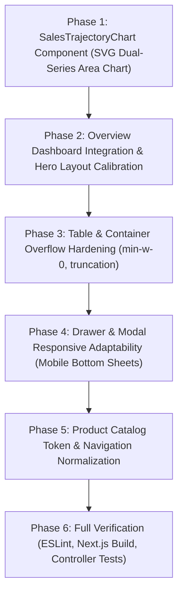

# Admin Portal UI/UX Audit, Layout Optimization & Analytics Charts Plan

**Date:** 2026-11-23  
**Status:** Ready for Review  
**Author:** Antigravity UI/UX Pro Max Engine  
**Target:** `apps/admin` (Next.js 16 App Router, React 19, Tailwind CSS v4)  
**Reference Alignment:** [sengtri457/ecommerce-MA-admin-portal](https://github.com/sengtri457/ecommerce-MA-admin-portal)

---

## 1. Executive Summary & Gap Analysis

Following the initial redesign, an in-depth audit of `apps/admin` reveals four core areas where layout friction, viewport overflows, missing visualizations, and color inconsistencies degrade user experience:

| Area | Current Gap / Friction Point | Target Redesign Solution |
| :--- | :--- | :--- |
| **1. Missing Analytics Charts** | Dashboard has 4 KPI cards and tables, but lacks the signature **Sales & Demand Trajectory Chart** from the reference repo (`revenue-chart.component.ts`). | Build `SalesTrajectoryChart.tsx`: interactive smooth dual-series area/line chart (High-Fashion Apparel in `#944434` Terracotta with gradient fill + Leather Goods & Accessories in dashed Obsidian `#18181F`), 7d/30d/90d range pills, 3-metric summary strip (Period Revenue, Orders, AOV), and hover tooltip. |
| **2. Table & Container Overflow** | Data tables on `/orders`, `/inventory`, `/products`, and `/` recent orders lack `min-w-0` on parent CSS Grid/Flex containers, causing layout blowout on viewports between 768px and 1280px (iPad, small laptops). | Add `min-w-0` and `overflow-x-auto` with sticky headers, proper column width limits (`truncate max-w-[200px]`), and responsive card views on mobile. |
| **3. Mobile / Tablet Drawer Clipping** | `CourierTelemetryDrawer.tsx` (`w-84`) and `OrderDrawer.tsx` (`max-w-xl`) cause clipping or horizontal scrolling on mobile viewports (< 640px) like iPhone SE / 13. | Refactor drawer widths to responsive constraints: `w-[calc(100vw-2rem)] sm:w-84 max-w-sm` with backdrop blur and safe-area inset padding. |
| **4. Inconsistent Token Usage in Catalog** | `apps/admin/app/products/*` and `ProductForm.tsx` still use raw `slate-*` tokens instead of the unified `neutral-*`, Obsidian (`#0E0E12`), and Terracotta (`#944434`) palette. | Migrate `/products` pages to clean neutral borders, brand terracotta accents, and underline navigation tabs. |
| **5. Layout Density & Hierarchy** | Hero banner on overview page (`app/page.tsx`) flex layout `flex-col lg:flex-row` wraps uncomfortably on 1024px-1280px laptop screens. | Switch hero layout to `flex-col xl:flex-row xl:items-center` with balanced spacing and refined typography. |

---

## 2. Detailed Page-by-Page Audit & Fix Specifications

### A. Overview Dashboard (`apps/admin/app/page.tsx`)
1. **Interactive Sales & Demand Trajectory Chart (`SalesTrajectoryChart.tsx`):**
   - Placed directly between the 4 `StatCard` KPI row and the recent orders/stock table row.
   - Header: "Sales & Demand Trajectory", subtext "Comparison of store revenue across luxury categories".
   - Time-range switcher: `Daily (7d)`, `Weekly (30d)`, `Monthly (90d)` with active pill `#0E0E12` text-white.
   - Quick Metrics Strip:
     - Total Period Revenue (`$X,XXX.XX`)
     - Completed Orders Count
     - Average Order Value (AOV)
   - Visual Rendering:
     - Pure SVG / Canvas area chart with smooth cubic bezier curves (`d="M... C..."`).
     - Series 1: High-Fashion Apparel (`#944434` Terracotta with 15% opacity gradient fill).
     - Series 2: Leather Goods & Accessories (dashed `#18181F` Obsidian line).
     - Hover crosshair with interactive dark floating tooltip (`#0E0E12` background, `#E07A5F` terracotta accent).
     - Custom legend with color indicator dots.
2. **Hero Banner Responsive Spacing:**
   - Replace rigid `w-96` on revenue snapshot with `w-full xl:w-96 shrink-0`.
   - Ensure `gap-6 xl:gap-8` so text is never cramped on laptop viewports (1024px - 1280px).
3. **Grid Column Containment:**
   - Add `min-w-0` to `lg:col-span-2 min-w-0` on Recent Orders card to stop table content from forcing grid expansion.

### B. Orders Queue & Slide-Over Drawer (`/orders`, `OrderDrawer.tsx`)
1. **Drawer Viewport Adaptability:**
   - Header & panel width: `w-full max-w-full sm:max-w-xl`.
   - Prevent background body scrolling when drawer is open (`document.body.style.overflow = "hidden"`).
   - Add `aria-modal="true"` and focus trap for accessibility.
2. **Table Density & Overflow:**
   - Table wrapper: `min-w-0 overflow-x-auto` with responsive scrollbar.
   - Customer column: add `max-w-[160px] truncate` for long emails and names.
   - Status tabs: add scroll-fade gradient indicators on left/right for touch devices.

### C. Stock & Inventory Matrix (`/inventory`, `VariantStockMatrix.tsx`)
1. **Table Width & Cell Sizing:**
   - Set table `min-w-[760px]` inside `overflow-x-auto` so columns don't collapse into illegibility.
   - SKU and Product columns with clean truncation.
   - Quick restock modal: add keyboard shortcut `Escape` to close and trap focus.
2. **Inline Edit UX:**
   - Visual feedback: input border highlights in `#944434` on active focus.
   - Small checkmark flash upon successful inline save before returning to normal state.

### D. Live Dispatch & Fleet Telemetry (`/dispatch`)
1. **Map Viewport & Responsive Drawers:**
   - On screen widths < 768px:
     - Telemetry drawer transforms from fixed floating box into a bottom sheet drawer (`bottom-4 left-4 right-4 sm:bottom-auto sm:top-4 sm:left-auto sm:right-4 sm:w-84`).
     - "Pending Orders Dock" changes from fixed width to responsive drawer.
   - Floating HUD Card: compact layout on mobile so it doesn't collide with the search bar or close buttons.
2. **Leaflet Container Resilience:**
   - Check container availability before re-attaching map.
   - Prevent Leaflet tile clipping with `invalidateSize()` trigger on window resize.

### E. Product Catalog (`/products`, `/products/new`, `/products/[id]/edit`)
1. **Color Token Normalization:**
   - Replace all `slate-*` classes with `neutral-*`, `#0E0E12`, and `#944434`.
   - Align table styling, active badges, and search inputs with `/orders` and `/inventory`.
2. **Department Tabs:**
   - Switch from generic buttons to underline tabs with `border-b-2 border-neutral-900 text-neutral-900`.

---

## 3. Implementation Phases & Ordered Checklist

### Phase 1: Interactive Sales Trajectory Chart Component
- Create `apps/admin/components/dashboard/SalesTrajectoryChart.tsx`:
  - Zero-dependency smooth cubic bezier SVG area chart.
  - Dual trajectories (High-Fashion Apparel vs Leather Goods).
  - 7d / 30d / 90d period switcher.
  - Metric summary strip (Total Revenue, Orders, AOV).
  - Crosshair & dark glassmorphic tooltip.

### Phase 2: Overview Dashboard Integration
- Update `apps/admin/app/page.tsx`:
  - Place `SalesTrajectoryChart` between KPI cards and tables.
  - Refactor hero banner layout for responsive `xl:flex-row` scaling.
  - Add `min-w-0` to grid columns.

### Phase 3: Table & Container Overflow Hardening
- Audit and apply `min-w-0`, `truncate`, and explicit `min-w-[...]` table constraints to:
  - `apps/admin/app/page.tsx` (Recent Orders table)
  - `apps/admin/app/orders/page.tsx` (Orders table)
  - `apps/admin/components/inventory/VariantStockMatrix.tsx` (Matrix table)
  - `apps/admin/app/products/page.tsx` (Products table)

### Phase 4: Drawer & Modal Responsive Adaptability
- Update `apps/admin/components/orders/OrderDrawer.tsx`:
  - Mobile full-width constraint, body scroll lock, clean animation.
- Update `apps/admin/components/dispatch/CourierTelemetryDrawer.tsx`:
  - Bottom sheet on mobile (<640px), floating top-right on desktop.
- Update `apps/admin/app/dispatch/page.tsx`:
  - Pending orders dock mobile-friendly dimensions.

### Phase 5: Product Catalog Token & Navigation Normalization
- Update `apps/admin/app/products/page.tsx`:
  - Replace `slate-*` with `neutral-*`, Obsidian `#0E0E12`, and Terracotta `#944434`.
  - Add underline department tabs (`All`, `Men`, `Women`, `Kids`, `Unisex`).
- Update `apps/admin/components/products/ProductForm.tsx` & `VariantMatrixEditor.tsx`:
  - Align borders, focus rings, and action buttons.

### Phase 6: Automated Verification & Monorepo Health
- Run `pnpm --filter admin lint` (0 errors, 0 warnings).
- Run `pnpm --filter admin build` (confirm 10/10 routes compiled).
- Run `python scripts/verify_admin_pipeline.py` (confirm 5/5 backend suites pass 100%).
- Run `pnpm --filter web build` (confirm storefront harmony).

---

## 4. Verification & Evidence Plan

1. **Visual Regression:** No horizontal viewport scrolling on screen widths from 375px (iPhone SE) to 1920px (Desktop).
2. **Chart Responsiveness:** SVG chart dynamically scales across 100% of container width with smooth curves and legible axis numbers.
3. **Compilation:** Strict TypeScript checking and ESLint 9 flat configuration with zero warnings or errors.
