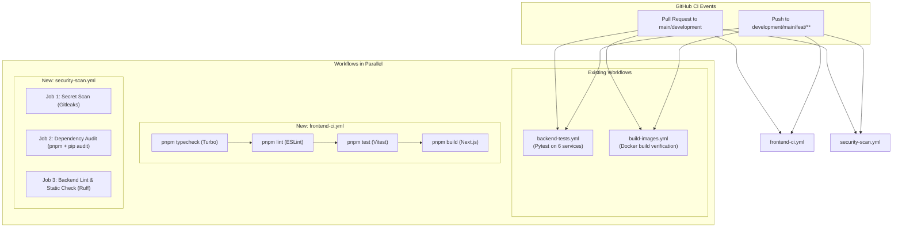

# CI DevSecOps Suite Implementation Plan

> **For Antigravity:** REQUIRED WORKFLOW: Use `.agent/workflows/execute-plan.md` to execute this plan in single-flow mode.

**Goal:** Expand GitHub Actions CI with full DevSecOps coverage: Turborepo-native frontend type checking and build verification, Gitleaks secret scanning, dependency vulnerability auditing, and Ruff backend static analysis.

**Architecture:** Modular multi-workflow approach consisting of two new workflows (`frontend-ci.yml` and `security-scan.yml`) operating alongside existing `backend-tests.yml` and `build-images.yml`. Frontend operations leverage Turborepo caching (`typecheck`, `lint`, `test`, `build`), while security checks enforce secret detection (`gitleaks`), runtime dependency CVE audits (`pnpm audit` and `pip-audit`), and fast Python code validation (`ruff`).

**Tech Stack:** GitHub Actions, Turborepo 2, pnpm 10, Next.js 16, TypeScript 5, Vitest, Gitleaks Action, pip-audit, Astral Ruff, Python 3.12.

---

## User Review Required

> [!IMPORTANT]
> - **Dependency Audit Severity Threshold**: `pnpm audit` is configured with `--audit-level=high --prod` so that only high and critical security vulnerabilities in runtime dependencies block pull requests, preventing routine minor dev-dependency advisories from disrupting merges.
> - **Typecheck Standardization**: Adding a `"typecheck": "tsc --noEmit"` script across `apps/web`, `apps/admin`, `packages/types`, and `packages/map-basemap`, wired into `turbo.json`, allows both CI and developers locally to run `pnpm typecheck` across all monorepo workspaces simultaneously.

---

## Proposed Changes



---

### Monorepo Scripts & Turborepo Pipeline

#### [MODIFY] `turbo.json`
- Register `typecheck` task in Turborepo pipeline with task dependency `^typecheck`.

```json
    "typecheck": {
      "dependsOn": ["^typecheck"],
      "inputs": ["$TURBO_DEFAULT$"]
    },
```

#### [MODIFY] `package.json`
- Add root `typecheck` script to trigger `turbo run typecheck`.

```json
    "typecheck": "turbo run typecheck",
```

#### [MODIFY] `apps/web/package.json`
- Add `"typecheck": "tsc --noEmit"`.

#### [MODIFY] `apps/admin/package.json`
- Add `"typecheck": "tsc --noEmit"`.

#### [MODIFY] `packages/types/package.json`
- Add `"scripts": { "typecheck": "tsc --noEmit" }`.

#### [MODIFY] `packages/map-basemap/package.json`
- Add `"typecheck": "tsc --noEmit"`.

---

### GitHub Actions Workflows

#### [NEW] `.github/workflows/frontend-ci.yml`
- Workflow triggers on `push` to `development`, `main`, `feat/**`, `fix/**` and `pull_request` to `development`, `main`.
- Runs on `ubuntu-latest`.
- Sets up pnpm 10.30.0 and Node.js 20 with pnpm store caching.
- Executes:
  1. `pnpm install --frozen-lockfile`
  2. `pnpm typecheck`
  3. `pnpm lint`
  4. `pnpm test`
  5. `pnpm build`

#### [NEW] `.github/workflows/security-scan.yml`
- Three parallel jobs:
  1. `secret-scan`:
     - Checks out code with `fetch-depth: 0`.
     - Executes `gitleaks/gitleaks-action@v2` to scan commits for exposed API tokens, private keys, and passwords.
  2. `dependency-audit`:
     - Checks out code.
     - Runs `pnpm audit --prod --audit-level=high` for frontend workspace dependencies.
     - Sets up Python 3.12 and runs `pip install pip-audit`, auditing `requirements.txt` across all backend services.
  3. `backend-lint-ruff`:
     - Sets up Python 3.12.
     - Installs `ruff`.
     - Runs `ruff check backend/` for lightning-fast linting and static analysis of FastAPI microservices and Django backend.

---

## Verification Plan

### Automated Tests
1. **Local Turborepo Pipeline Verification**:
   ```bash
   pnpm typecheck
   pnpm lint
   pnpm test
   ```
2. **Local Security & Quality Verification**:
   ```bash
   pnpm audit --prod --audit-level=high
   python -m pip install ruff pip-audit
   ruff check backend/
   ```
3. **Workflow Syntax & Schema Verification**:
   - Verify YAML structure, action versions, and environment configurations of `.github/workflows/frontend-ci.yml` and `.github/workflows/security-scan.yml`.

### Manual Verification
- Confirm that both workflow files appear in GitHub Actions tab on push/PR with clear, individual status checks.
